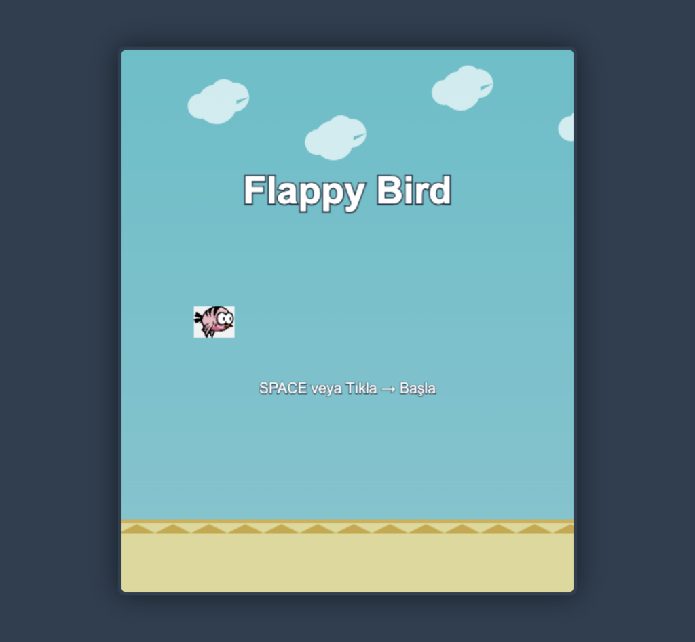
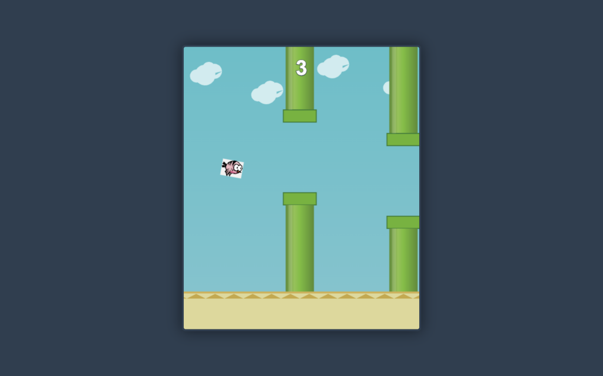

# 🐦 Flappy Bird - YMH219

**Nesne Tabanlı Programlama (YMH 219)** dersi kapsamında geliştirilen Windows Forms tabanlı Flappy Bird oyunu.

## 📋 Proje Hakkında

Bu proje, Windows Forms üzerinde zamanlayıcı (Timer) ve klavye olaylarının kullanıldığı basit bir 2D oyundur. Görsel bileşenler çalışma zamanında hareket ettirilmekte, çarpışma kontrolü ve oyun durumu nesne tabanlı bir yapı ile yönetilmektedir.

## 🛠️ Kullanılan Teknolojiler

- **C# / .NET 6.0** - Programlama dili ve çatı
- **Windows Forms** - Masaüstü arayüz kütüphanesi
- **Visual Studio 2022** - Geliştirme ortamı
- **GDI+** - 2D grafik çizimi (System.Drawing)

## 🚀 Kurulum ve Çalıştırma

### 1. Windows Forms (C# / .NET) - Ana Proje
1. Bu depoyu klonlayın:
   ```bash
   git clone https://github.com/meryemmelek41-mm/YMH219-FlappyBird.git
   ```
2. `FlappyBird.sln` dosyasını Visual Studio ile açın.
3. `F5` tuşuna basarak veya **Debug > Start Debugging** ile çalıştırın.

**Gereksinimler:**
- Visual Studio 2022 veya üzeri
- .NET 6.0 SDK (Windows Forms desteği ile)

### 2. Web / HTML5 Önizleme (Tarayıcıda Anında Oynama)
Windows ortamı olmayan veya oyunu doğrudan tarayıcıda denemek isteyenler için:
- Projedeki `preview/index.html` dosyasını herhangi bir internet tarayıcısında (Chrome, Edge, Safari, Firefox) çift tıklayarak açmanız yeterlidir.

## 🎮 Temel Özellikler

- **Kuş Kontrolü:** SPACE veya Yukarı Ok tuşu (veya fare tıklaması) ile kuş yukarı zıplar; yer çekimi etkisiyle aşağı iner.
- **Özel Kuş Görseli:** Yüklenen pembe kuş görseli projeye gömülü kaynak olarak entegre edilmiştir.
- **Engeller:** Borular ekranın sağından sola doğru hareket eder; ekran dışına çıkan borular otomatik olarak yeniden oluşturulur.
- **Çarpışma Kontrolü:** Kuş borulara, zemine veya tavana çarptığında oyun durur ve "Game Over" ekranı gösterilir.
- **Skor Sistemi:** Her başarılı boru geçişinde skor artar.
- **Zorluk Artışı:** Her 5 skorda boru hızı biraz artar.
- **En Yüksek Skor:** En iyi skor dosyaya kaydedilir ve kalıcı olarak saklanır.
- **Yeniden Başlatma:** Game Over sonrası tıklama veya SPACE ile oyun yeniden başlatılabilir.

## 🏗️ Proje Yapısı

```
YMH219-FlappyBird/
├── FlappyBird.sln              # Visual Studio Solution dosyası
├── .gitignore                  # Git ignore kuralları
├── README.md                   # Proje dokümantasyonu
├── preview/                    # Web / HTML5 oynanabilir önizleme sürümü
│   ├── index.html              # Tarayıcı oyunu
│   └── bird.png                # Pembe kuş görseli
└── FlappyBird/
    ├── FlappyBird.csproj       # Proje dosyası (.NET 6.0 WinForms)
    ├── Program.cs              # Ana giriş noktası
    ├── FormMain.cs             # Ana form - oyun döngüsü ve çizim
    ├── FormMain.Designer.cs    # Form tasarım dosyası
    ├── Bird.cs                 # Kuş sınıfı (konum, fizik, görsel çizim)
    ├── Pipe.cs                 # Boru sınıfı (engel yönetimi)
    ├── GameState.cs            # Oyun durumu sınıfı (skor, durum)
    ├── Resources/
    │   └── bird.png            # C# projesine gömülü kuş görseli
    └── screenshots/
        ├── menu.png            # Menü ekran görüntüsü
        └── gameplay.png        # Oynanış ekran görüntüsü
```

## 📸 Ekran Görüntüleri

### Oyun Menüsü


### Oynanış


## ⚙️ Nesne Tabanlı Tasarım

| Sınıf | Sorumluluk |
|-------|-----------|
| `Bird` | Kuşun konumu, hızı, yer çekimi, zıplama ve çizim işlemleri |
| `Pipe` | Boru engelleri: konum, hareket, çarpışma alanı ve çizim |
| `GameState` | Oyun durumu (Menü/Oyun/GameOver), skor yönetimi, en iyi skor kaydı |
| `FormMain` | Oyun döngüsü (Timer), klavye/fare olayları, çarpışma kontrolü, ekran çizimi |

## ⚠️ Bilinen Sınırlamalar

- Oyun yalnızca Windows işletim sisteminde çalışır (Windows Forms bağımlılığı).
- Ses efektleri bulunmamaktadır.
- Grafikler kod ile çizilmektedir (harici resim dosyası kullanılmamıştır).

## 📝 Geliştirme Notları

- `DoubleBuffered = true` ile ekran titremesi (flicker) engellenmiştir.
- Çarpışma kontrolünde kuşun hitbox'ı biraz küçültülerek daha adil bir oynanış sağlanmıştır.
- GDI+ ile SmoothingMode.AntiAlias kullanılarak daha düzgün çizimler elde edilmiştir.

---

**Öğrenci:** Meryem Melek Şimşek  
**Öğrenci No:** 250541017  
**Ders:** Nesne Tabanlı Programlama (YMH 219)
